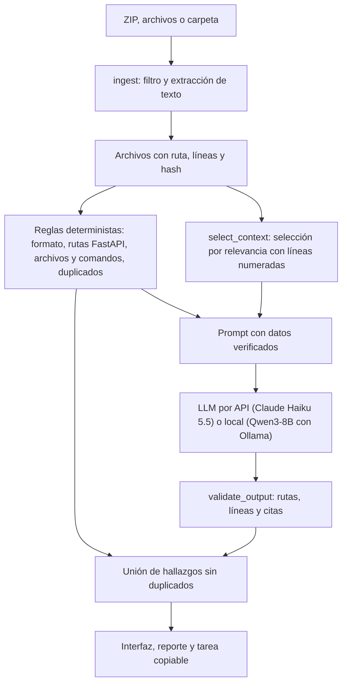

# SkillDoc Check

Diagnóstico previo al desarrollo para proyectos que usan asistentes de programación (Claude Code, Codex y similares). Revisa si las skills (`SKILL.md`), el README y el código de un repositorio siguen diciendo lo mismo, y para cada problema muestra la evidencia con archivo y línea, propone una corrección y arma una tarea lista para copiar al asistente.

Proyecto 3 de CC3092 Deep Learning y Sistemas Inteligentes. Equipo: Joel Jaquez y Kevin.

## Qué detecta

| Tipo | Ejemplo |
| --- | --- |
| README vs código | El README documenta `POST /predict` y el código define `POST /forecast`. |
| Skill desactualizada | Una skill manda poner pruebas en `tests/test_predict.py`, que ya no existe. |
| Traslape entre skills | Dos skills dicen "úsame para cualquier cambio en la API". |
| Instrucción redundante | La misma instrucción repetida en varias skills. |
| Formato de `SKILL.md` | Frontmatter sin `name` o `description`, o que no sigue la [especificación de Agent Skills](https://agentskills.io/specification). |

Cada hallazgo se marca como comprobado, posible conflicto o evidencia insuficiente. Un traslape entre skills nunca se marca como comprobado, porque eso solo se sabría observando al asistente real.

No ejecuta código del repositorio, no instala skills y no cambia archivos.

## Cómo funciona



- Sin RAG ni embeddings: el modelo solo ve los archivos que la persona sube.
- Técnica de adaptación: prompting con instrucciones, ejemplos breves y salida JSON con esquema. No hay fine-tuning.
- Los dos proveedores reciben exactamente el mismo prompt, contexto y esquema (`src/model_provider.py`).

## Instalación

Requiere Python 3.12.

```bash
python3.12 -m venv .venv
source .venv/bin/activate
pip install -r requirements.txt
cp .env.example .env
```

### Modo API

Poner la clave de Anthropic en `.env` (`ANTHROPIC_API_KEY=...`). El archivo `.env` está en `.gitignore` y nunca se sube.

### Modo local (sin internet)

Instalar [Ollama](https://ollama.com) y descargar el modelo antes de desconectarse:

```bash
ollama pull qwen3:8b
```

Con el modelo descargado y las dependencias instaladas, el modo local funciona sin red.

Notas de la configuración local (se registran en cada corrida):

- `think` se activa o no según la iteración (V4 lo activa). Con razonamiento apagado se usa `temperature` 0; con razonamiento, los valores que recomienda Qwen (0.6, `top_p` 0.95, `top_k` 20). Semilla fija.
- El contexto (`num_ctx`) se elige por solicitud entre 8192, 12288, 16384 y 24576, el más chico que alcance. En una GPU de 8 GB, `qwen3:8b` con 8192 cabe completo en la GPU y con 16384 ya no, lo que hace la inferencia mucho más lenta. `SKILLDOC_LOCAL_NUM_CTX` fija un valor.
- Si el prompt no cabe, Ollama lo recorta en silencio; el proveedor lo detecta y reporta un error en vez de analizar un texto cortado.

## Uso

Interfaz web:

```bash
streamlit run app.py
```

Por consola:

```bash
python -m src.cli examples/stale_project --provider api           # análisis completo
python -m src.cli examples/stale_project --provider api --tasks   # con la tarea copiable de cada hallazgo
python -m src.cli proyecto.zip --provider local
python -m src.cli examples/stale_project --no-llm                 # solo reglas, sin costo
```

Límites de diseño: ZIP de hasta 10 MB, 40 archivos de texto y unos 10 mil tokens de archivos por análisis. Se omiten `.env`, `.git`, `.venv`, `node_modules`, binarios y archivos generados.

## Evaluación

Los casos se generan a partir de repos base limpios (`eval/repos/`) con modificaciones controladas definidas en `eval/case_defs_<autor>.py`. El generador calcula las líneas de cada etiqueta.

```bash
python -m eval.build_cases --check      # genera eval/cases/ y eval/cases.jsonl y revisa etiquetas con las reglas
python -m eval.run_eval --provider api --iteration V4 --split dev
python -m eval.run_eval --provider local --iteration V4 --split test
python -m eval.score <carpeta de la corrida>
python -m eval.compare_models --runs api=<corrida> local=<corrida>   # tabla y gráfica pareadas
python -m eval.compare_tokens --cases sd01 sd02 sd03 inv02 bk03 nt02
```

- `run_eval` guarda una fila por caso en `eval/results/runs.csv` (tokens, costo, latencia, hash del contexto, errores) y la salida completa en `eval/results/runs/<corrida>/`. Tiene un tope de gasto (`--max-cost`, 1 USD por defecto).
- Partición: las familias `weather`, `inventory`, `booking` y `skilldoc` son de desarrollo. La familia `notes` es la prueba final y no se usa para ajustar prompts.
- Casos: 36 (26 dev y 10 test). Joel escribió 21 (familias `weather`, `inventory`, `booking`, `skilldoc` en dev y `notes` en test) y Kevin 15 (`library` en dev y `tickets` en test). Cada uno revisó las etiquetas del otro (`reviewed_by` en `eval/cases.jsonl`).
- `eval.score` guarda `score.json` junto a la corrida y una fila por corrida en `eval/results/scores.csv`. `eval.compare_models` solo compara los casos que están en todas las corridas.
- La regla para emparejar hallazgos con etiquetas está en la sección siguiente.
- El historial de iteraciones está en `docs/experiment_log.md`.

### Regla para emparejar hallazgos con etiquetas

Se fijó antes de correr los modelos para no ajustarla a los resultados.

1. Solo cuentan como predicción los hallazgos con estado comprobado o posible conflicto. Los de evidencia insuficiente se reportan aparte.
2. Un hallazgo empareja con una etiqueta si tiene el mismo tipo y al menos una evidencia en un archivo de la etiqueta cuyas líneas se cruzan con las esperadas, con 2 líneas de tolerancia.
3. Emparejamiento uno a uno. Predichos sin pareja son falsos positivos y etiquetas sin pareja son falsos negativos.
4. Las etiquetas opcionales no cuentan como falso negativo si faltan ni como falso positivo si aparecen.

### Iteraciones

| Iteración | Cambio |
| --- | --- |
| V0 | Prompt simple (baseline), mismo modelo y mismo contexto |
| V1 | Prompt estructurado con tipos, reglas de evidencia y ejemplos |
| V2 | + reglas deterministas y validación de citas |
| V3 | Prompt v2 con criterios para traslape, redundancia y lo que no es contradicción |
| V4 | V3 con razonamiento previo del modelo (versión final) |

## Estructura

```text
app.py                     interfaz Streamlit
src/
  ingest.py                carga de ZIP, archivos o carpeta
  deterministic_checks.py  reglas sin LLM
  select_context.py        selección de contexto y líneas numeradas
  schemas.py               contrato común y esquema JSON
  model_provider.py        interfaz de proveedores
  api_provider.py          Claude por API
  local_provider.py        Qwen3 con Ollama
  validate_output.py       validación de rutas, líneas y citas
  analyze.py               pipeline e iteraciones
  handoff.py               reporte y tarea copiable
  cli.py                   uso por consola
prompts/                   prompts versionados
eval/                      casos, generador, scripts y resultados
examples/                  proyectos de ejemplo para la demo (stale_project con problemas, clean_project sin ellos)
docs/                      registro de experimentos
```
