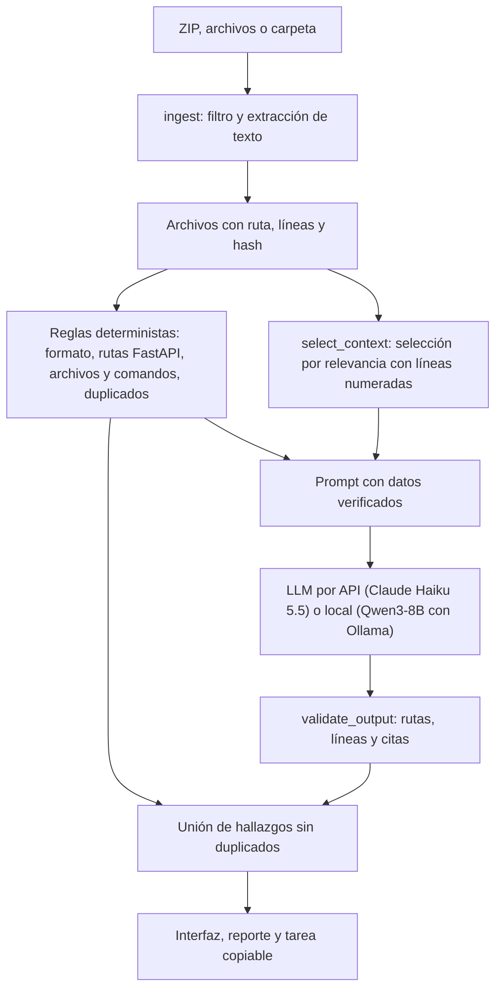

# SkillDoc Check

Diagnóstico previo al desarrollo para proyectos que usan asistentes de programación (Claude Code, Codex y similares). Revisa si las skills (`SKILL.md`), el README y el código de un repositorio siguen diciendo lo mismo, y para cada problema muestra la evidencia con archivo y línea, propone una corrección y arma una tarea lista para copiar al asistente.

Proyecto 3 de CC3092 Deep Learning y Sistemas Inteligentes. Equipo: Joel Jaquez y Kevin.

## Qué detecta

| Tipo | Ejemplo |
| --- | --- |
| README vs código | El README documenta `POST /predict` y el código define `POST /forecast`. |
| Skill desactualizada | Una skill manda poner pruebas en `tests/test_predict.py`, que ya no existe. |
| Traslape entre skills | Dos skills dicen "úsame para cualquier cambio en la API". |
| Instrucción redundante | La misma instrucción repetida en varias skills. |
| Formato de `SKILL.md` | Frontmatter sin `name` o `description`, o que no sigue la [especificación de Agent Skills](https://agentskills.io/specification). |

Cada hallazgo se marca como comprobado, posible conflicto o evidencia insuficiente. Un traslape entre skills nunca se marca como comprobado, porque eso solo se sabría observando al asistente real.

No ejecuta código del repositorio, no instala skills y no cambia archivos.

## Cómo funciona



- Sin RAG ni embeddings: el modelo solo ve los archivos que la persona sube.
- Técnica de adaptación: prompting con instrucciones, ejemplos breves y salida JSON con esquema. No hay fine-tuning.
- Los dos proveedores reciben exactamente el mismo prompt, contexto y esquema (`src/model_provider.py`).

## Instalación

Requiere Python 3.12.

```bash
python3.12 -m venv .venv
source .venv/bin/activate
pip install -r requirements.txt
cp .env.example .env
```

### Modo API

Poner la clave de Anthropic en `.env` (`ANTHROPIC_API_KEY=...`). El archivo `.env` está en `.gitignore` y nunca se sube.

### Modo local (sin internet)

Instalar [Ollama](https://ollama.com) y descargar el modelo antes de desconectarse:

```bash
ollama pull qwen3:8b
```

Con el modelo descargado y las dependencias instaladas, el modo local funciona sin red.

Notas de la configuración local (se registran en cada corrida):

- `think` se activa o no según la iteración (V4 lo activa). Con razonamiento apagado se usa `temperature` 0; con razonamiento, los valores que recomienda Qwen (0.6, `top_p` 0.95, `top_k` 20). Semilla fija.
- El contexto (`num_ctx`) se elige por solicitud entre 8192, 12288, 16384 y 24576, el más chico que alcance. En una GPU de 8 GB, `qwen3:8b` con 8192 cabe completo en la GPU y con 16384 ya no, lo que hace la inferencia mucho más lenta. `SKILLDOC_LOCAL_NUM_CTX` fija un valor.
- Si el prompt no cabe, Ollama lo recorta en silencio; el proveedor lo detecta y reporta un error en vez de analizar un texto cortado.

## Uso

Interfaz web:

```bash
streamlit run app.py
```

Por consola:

```bash
python -m src.cli examples/stale_project --provider api           # análisis completo
python -m src.cli examples/stale_project --provider api --tasks   # con la tarea copiable de cada hallazgo
python -m src.cli proyecto.zip --provider local
python -m src.cli examples/stale_project --no-llm                 # solo reglas, sin costo
```

Límites de diseño: ZIP de hasta 10 MB, 40 archivos de texto y unos 10 mil tokens de archivos por análisis. Se omiten `.env`, `.git`, `.venv`, `node_modules`, binarios y archivos generados.

## Evaluación

Los casos se generan a partir de repos base limpios (`eval/repos/`) con modificaciones controladas definidas en `eval/case_defs_<autor>.py`. El generador calcula las líneas de cada etiqueta.

```bash
python -m eval.build_cases --check      # genera eval/cases/ y eval/cases.jsonl y revisa etiquetas con las reglas
python -m eval.run_eval --provider api --iteration V4 --split dev
python -m eval.run_eval --provider local --iteration V4 --split test
python -m eval.score <carpeta de la corrida>
python -m eval.compare_models --runs api=<corrida> local=<corrida>   # tabla y gráfica pareadas
python -m eval.compare_tokens --cases sd01 sd02 sd03 sd04 w01 inv01 inv02 inv03 bk03 bk05
```

- `run_eval` guarda una fila por caso en `eval/results/runs.csv` (tokens, costo, latencia, hash del contexto, errores) y la salida completa en `eval/results/runs/<corrida>/`. Tiene un tope de gasto (`--max-cost`, 1 USD por defecto).
- Partición: las familias `weather`, `inventory`, `booking`, `skilldoc` y `library` son de desarrollo (26 casos). Las familias `notes` y `tickets` son la prueba final (10 casos) y no se usaron para ajustar prompts ni reglas.
- Casos: 36 (26 dev y 10 test). Joel escribió 21 (familias `weather`, `inventory`, `booking`, `skilldoc` en dev y `notes` en test) y Kevin 15 (`library` en dev y `tickets` en test). Cada uno revisó las etiquetas del otro (`reviewed_by` en `eval/cases.jsonl`).
- `eval.score` guarda `score.json` junto a la corrida y una fila por corrida en `eval/results/scores.csv`. `eval.compare_models` solo compara los casos que están en todas las corridas.
- La regla para emparejar hallazgos con etiquetas está en la sección siguiente.
- El historial de iteraciones está en `docs/experiment_log.md`.
- Los pasos exactos para obtener cada tabla del informe están en la sección "Reproducir las métricas del informe".

### Regla para emparejar hallazgos con etiquetas

Se fijó antes de correr los modelos para no ajustarla a los resultados.

1. Solo cuentan como predicción los hallazgos con estado comprobado o posible conflicto. Los de evidencia insuficiente se reportan aparte.
2. Un hallazgo empareja con una etiqueta si tiene el mismo tipo y al menos una evidencia en un archivo de la etiqueta cuyas líneas se cruzan con las esperadas, con 2 líneas de tolerancia.
3. Emparejamiento uno a uno. Predichos sin pareja son falsos positivos y etiquetas sin pareja son falsos negativos.
4. Las etiquetas opcionales no cuentan como falso negativo si faltan ni como falso positivo si aparecen.

### Iteraciones

| Iteración | Cambio |
| --- | --- |
| V0 | Prompt simple (baseline), mismo modelo y mismo contexto |
| V1 | Prompt estructurado con tipos, reglas de evidencia y ejemplos |
| V2 | + reglas deterministas y validación de citas |
| V3 | Prompt v2 con criterios para traslape, redundancia y lo que no es contradicción |
| V4 | V3 con razonamiento previo del modelo (versión final) |

## Reproducir las métricas del informe

Todos los comandos se corren desde la raíz del repositorio con el entorno activado (sección Instalación). Cada `run_eval` imprime al inicio el identificador de su corrida (`Corrida 20261031-221455_api_V4_selected`); ese identificador es el que se pasa a `eval.score` y a `eval.compare_models`.

### Antes de empezar

- **Qué trae el repositorio y qué se regenera.** El repo incluye los resúmenes de todas las corridas del informe: `eval/results/runs.csv` (una fila por caso), `eval/results/scores.csv` (una fila por corrida) y las tablas y gráficas `eval/results/*.md`, `*.csv` y `*.png`. La salida completa de cada corrida (`eval/results/runs/`) no se sube; se vuelve a generar al correr los comandos.
- **Los casos se regeneran idénticos.** `python -m eval.build_cases --check` reconstruye `eval/cases/` y `eval/cases.jsonl` desde `eval/repos/` y `eval/case_defs_*.py`. Si después `git status` no muestra cambios, los casos son exactamente los del informe.
- **Los resultados con la API son equivalentes, no idénticos.** Claude Haiku 5.5 no acepta `temperature`, así que dos corridas iguales pueden diferir. En nuestras repeticiones el F1 varió entre 3 y 5 puntos (por ejemplo, la prueba final con V4 dio 1.00 en la corrida del informe y 0.97 al repetirla el 6 de noviembre desde una copia limpia del repo). Las conclusiones no cambian.
- **El modelo local** (`qwen3:8b`, digest `500a1f067a9f`, Q4_K_M) necesita Ollama corriendo (`ollama serve`, la app de Ollama o `brew services start ollama`) y el modelo descargado. La calidad no depende de la máquina, pero los tiempos sí: el informe tiene corridas en una RTX 4060 Ti de 8 GB y en una MacBook Pro M3 Max.
- **Costo aproximado de reproducir:** unos 0.03 USD de API para la prueba final, unos 0.04 USD para desarrollo y unos 0.05 USD para T1. Los experimentos D1 y A2 usan la cuenta de Claude Code (unos 0.40 y 0.80 USD de uso).

### 1. Prueba final (tabla `eval/results/final_test.*`)

```bash
python -m eval.build_cases --check
python -m eval.run_eval --provider api   --iteration V4 --split test   # sistema final por API
python -m eval.run_eval --provider api   --iteration V0 --split test   # baseline: mismo modelo, prompt simple
python -m eval.run_eval --provider local --iteration V4 --split test   # sistema final local
python -m eval.run_eval --provider local --iteration V3 --split test   # local sin razonamiento
python -m eval.score <corrida>                                         # una vez por cada corrida anterior
python -m eval.compare_models --runs api=<corrida API V4> local=<corrida local V4> baseline=<corrida API V0> --out eval/results/final_test
```

| Configuración | Resultado del informe (10 casos, 17 problemas) |
| --- | --- |
| API V4 | F1 1.00 (17 de 17, 0 falsas alarmas), 0.0011 USD y 5.3 s por análisis |
| API V0 (baseline) | F1 0.41 (12 de 17, 30 falsas alarmas) |
| Local V4 | F1 0.69 (10 de 17, 2 falsas alarmas), 31.5 s por análisis |
| Local V3 | F1 0.53 |

Corridas del informe en `eval/results/scores.csv`: `20261031-221455_api_V4_selected_final`, `20261031-221549_api_V0_selected_final`, `20261031-221753_local_V4_selected_final` y `20261031-222308_local_V3_selected_final`.

### 2. Iteraciones V0 a V4 (tabla de `docs/experiment_log.md`)

Se hicieron sobre los 12 casos de desarrollo de Joel, con la API:

```bash
CASOS="w01 inv01 inv02 inv03 inv04 inv05 inv06 bk01 bk02 bk03 bk04 bk05"
for it in V0 V1 V2 V3 V4; do
  python -m eval.run_eval --provider api --iteration $it --split dev --cases $CASOS
done
python -m eval.score <corrida>   # una vez por cada iteración
```

Resultado del informe (F1): V0 0.26, V1 0.68, V2 0.62, V3 0.86 y 0.91, V4 1.00 y 0.97 (V3 y V4 se corrieron dos veces para medir la variación).

### 3. API contra local en desarrollo (tablas `eval/results/m1_*`)

```bash
python -m eval.run_eval --provider api   --iteration V4 --split dev
python -m eval.run_eval --provider local --iteration V4 --split dev
python -m eval.run_eval --provider local --iteration V3 --split dev
python -m eval.score <corrida>   # una vez por cada corrida
python -m eval.compare_models --runs api=<corrida API V4> local=<corrida local V4> --out eval/results/m1_api_vs_local_dev
python -m eval.compare_models --runs local_V4=<corrida local V4> local_V3=<corrida local V3> --out eval/results/m1_local_think_vs_off
```

Resultado del informe (26 casos, 31 problemas): API V4 F1 0.91, local V4 0.58, local V3 0.50. Corridas del informe en `eval/results/scores.csv`: `20261030-121703_api_V4_selected_m1api`, `20261030-111927_local_V4_selected_m1` y `20261030-114900_local_V3_selected_m1off`.

### 4. Experimento T1 de tokens (`eval/results/tokens_comparison.csv`)

```bash
python -m eval.compare_tokens --cases sd01 sd02 sd03 sd04 w01 inv01 inv02 inv03 bk03 bk05 --iteration V4
python -m eval.score <corrida raw>
python -m eval.score <corrida selected>
```

Resultado del informe: la selección de contexto ahorra 55.9 % de tokens de entrada en los 4 casos grandes (`sd01` a `sd04`) y 0 % en los 6 pequeños; recall 1.00 con archivos completos y 0.94 con selección.

### 5. Experimentos con Claude Code (D1 y A2)

Requieren [Claude Code](https://code.claude.com) instalado (`claude` en la terminal) y con sesión iniciada. El agente corre en modo no interactivo con Claude Sonnet 5.5 y solo herramientas para leer y editar archivos, siempre sobre copias temporales de los casos. El uso se cobra a esa cuenta.

```bash
# D1: revisar con Claude Code contra revisar con SkillDoc Check (10 casos de prueba)
python -m eval.compare_agent_detect --cases nt01 nt02 nt03 nt04 nt05 tk01 tk02 tk03 tk04 tk05

# A2: el agente corrige solo, con el diagnóstico por API y con el diagnóstico local (6 casos)
python -m eval.compare_agent --cases nt02 nt03 nt05 tk02 tk04 tk05 --conditions A B C
```

Los scripts escriben `eval/results/agent_detect.csv` y `eval/results/agent_handoff.csv`; las tablas `.md` del mismo nombre resumen esos CSV.

| Experimento | Resultado del informe |
| --- | --- |
| D1 | Claude Code F1 0.97 a 0.041 USD por revisión; SkillDoc Check API F1 1.00 a 0.0011 USD |
| A2 | Agente solo 14 de 14 y 0.338 USD; con SkillDoc por API 14 de 14 y 0.253 USD con la mitad de vueltas; con SkillDoc local 8 de 14 y 0.173 USD |

## Estructura

```text
app.py                     interfaz Streamlit
src/
  ingest.py                carga de ZIP, archivos o carpeta
  deterministic_checks.py  reglas sin LLM
  select_context.py        selección de contexto y líneas numeradas
  schemas.py               contrato común y esquema JSON
  model_provider.py        interfaz de proveedores
  api_provider.py          Claude por API
  local_provider.py        Qwen3 con Ollama
  validate_output.py       validación de rutas, líneas y citas
  analyze.py               pipeline e iteraciones
  handoff.py               reporte y tarea copiable
  cli.py                   uso por consola
prompts/                   prompts versionados
eval/                      casos, generador, scripts y resultados
examples/                  proyectos de ejemplo para la demo (stale_project con problemas, clean_project sin ellos)
docs/                      registro de experimentos
```
