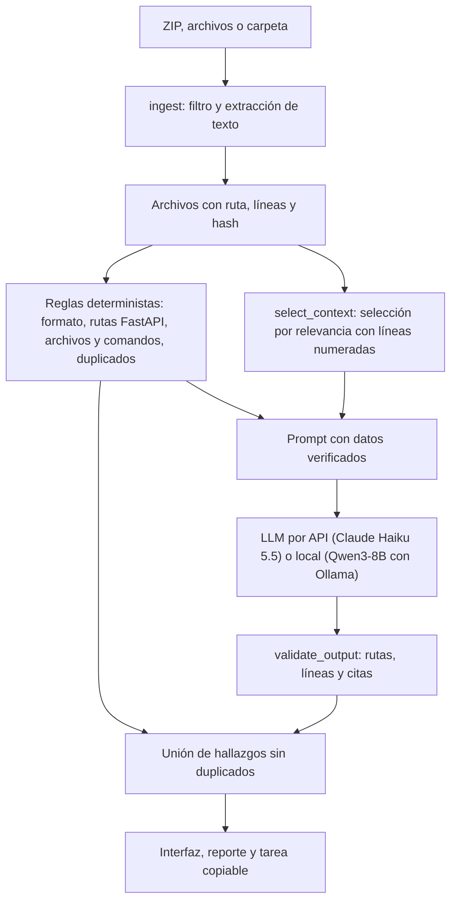

# SkillDoc Check

Diagnóstico previo al desarrollo para proyectos que usan asistentes de programación (Claude Code, Codex y similares). Revisa si las skills (`SKILL.md`), el README y el código de un repositorio siguen diciendo lo mismo, y para cada problema muestra la evidencia con archivo y línea, propone una corrección y arma una tarea lista para copiar al asistente.

Proyecto 3 de CC3092 Deep Learning y Sistemas Inteligentes. Equipo: Joel Jaquez y Kevin.

## Qué detecta

| Tipo | Ejemplo |
| --- | --- |
| README vs código | El README documenta `POST /predict` y el código define `POST /forecast`. |
| Skill desactualizada | Una skill manda poner pruebas en `tests/test_predict.py`, que ya no existe. |
| Traslape entre skills | Dos skills dicen "úsame para cualquier cambio en la API". |
| Instrucción redundante | La misma instrucción repetida en varias skills. |
| Formato de `SKILL.md` | Frontmatter sin `name` o `description`, o que no sigue la [especificación de Agent Skills](https://agentskills.io/specification). |

Cada hallazgo se marca como comprobado, posible conflicto o evidencia insuficiente. Un traslape entre skills nunca se marca como comprobado, porque eso solo se sabría observando al asistente real.

No ejecuta código del repositorio, no instala skills y no cambia archivos.

## Cómo funciona



- Sin RAG ni embeddings: el modelo solo ve los archivos que la persona sube.
- Técnica de adaptación: prompting con instrucciones, ejemplos breves y salida JSON con esquema. No hay fine-tuning.
- Los dos proveedores reciben exactamente el mismo prompt, contexto y esquema (`src/model_provider.py`).

## Instalación

Requiere Python 3.12.

```bash
python3.12 -m venv .venv
source .venv/bin/activate
pip install -r requirements.txt
cp .env.example .env
```

### Modo API

Poner la clave de Anthropic en `.env` (`ANTHROPIC_API_KEY=...`). El archivo `.env` está en `.gitignore` y nunca se sube.

### Modo local (sin internet)

Instalar [Ollama](https://ollama.com) y descargar el modelo antes de desconectarse:

```bash
ollama pull qwen3:8b
```

Con el modelo descargado y las dependencias instaladas, el modo local funciona sin red.

## Uso

Por consola:

```bash
python -m src.cli examples/stale_project --provider api           # análisis completo
python -m src.cli examples/stale_project --provider api --tasks   # con la tarea copiable de cada hallazgo
python -m src.cli proyecto.zip --provider local
python -m src.cli examples/stale_project --no-llm                 # solo reglas, sin costo
```

Límites de diseño: ZIP de hasta 10 MB, 40 archivos de texto y unos 10 mil tokens de archivos por análisis. Se omiten `.env`, `.git`, `.venv`, `node_modules`, binarios y archivos generados.
